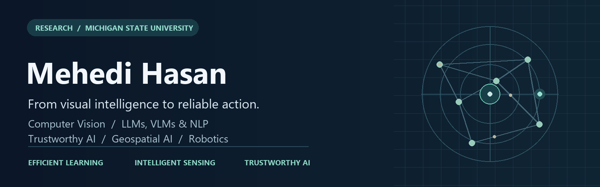

<picture>
  <source media="(prefers-reduced-motion: reduce)" srcset="assets/research-focus-v2.png">
  
</picture>

### Graduate Research Assistant · Michigan State University

M.S. in Biosystems Engineering &nbsp; / &nbsp; B.S. in Computer Science, BRAC University

**[Website](https://sites.google.com/view/i-am-mehedi)** &nbsp; · &nbsp; **[Google Scholar](https://scholar.google.com/citations?user=i_9-VFoAAAAJ&hl=en)** &nbsp; · &nbsp; **[LinkedIn](https://www.linkedin.com/in/mehedihasan96/)** &nbsp; · &nbsp; **[Email](mailto:hasanme1@msu.edu)**

**Computer Vision · LLMs, VLMs & NLP · Trustworthy AI · Geospatial AI · Robotics**

**Preparing for Fall 2027 PhD applications**

[Research interests](#research-interests) &nbsp; / &nbsp; [Selected research](#selected-research) &nbsp; / &nbsp; [Background](#background)

---

I work at the intersection of **computer vision, intelligent sensing, and efficient, trustworthy AI**. At Michigan State University, I develop machine-vision and robotic-manipulation methods for automated handling of deformable catfish fillets. My broader research connects foundation-model efficiency and reliability with medical imaging, remote sensing, and engineering systems.

I am interested in how learning systems can **perceive complex environments, generalize under changing conditions, and support reliable decisions and actions**.

## Research interests

<table>
<tr>
<td width="50%" valign="top">

### 01 · Vision, robotics & intelligent sensing

Detection and tracking · Robotic perception and manipulation · Multi-sensor fusion · RGB/RGB-D imaging · 3D geometry and reconstruction

</td>
<td width="50%" valign="top">

### 02 · Remote sensing & intelligent systems

Geospatial learning · UAV/satellite sensing · Multispectral and hyperspectral imaging · Transportation sensing · Precision agriculture and plant phenotyping

</td>
</tr>
<tr>
<td width="50%" valign="top">

### 03 · Trustworthy, efficient & foundation AI

LLMs and NLP · Vision-language and vision-language-action models · Parameter-efficient adaptation · Compression and distillation · Multimodal learning

</td>
<td width="50%" valign="top">

### 04 · Privacy-preserving & federated AI

Federated learning · Encrypted analytics · Privacy-aware distributed learning · Secure networked systems · Resource-constrained edge intelligence

</td>
</tr>
</table>

## Selected research

<table>
<tr>
<td width="50%" valign="top">

### [LoveDA · Land-cover mapping](https://github.com/mhasan96/LoveDA-Remote-Sensing)
**REMOTE SENSING / RELIABLE SEGMENTATION**

SegFormer-B2 segmentation with weighted cross-entropy–Dice training, class-wise error analysis, and confidence calibration.

**53.09% mIoU** on **1,669 validation images** with native-resolution overlapping tiled inference, versus 49.45% with 512 × 512 resized inference.

*Ongoing experimental project* · [Protocols & results](https://github.com/mhasan96/LoveDA-Remote-Sensing)

</td>
<td width="50%" valign="top">

### [AquaPick · Vision to manipulation](https://github.com/mhasan96/AquaPick)
**ROBOTIC PERCEPTION / DEFORMABLE OBJECTS**

Real-time detection, Kalman tracking, conveyor-motion prediction, camera-to-robot mapping, and suction-target generation for deformable fillets.

Dataset development and physical system evaluation connect perception quality to handling performance.

*Journal manuscript under review; related SPIE/ASABE work* · [Project](https://github.com/mhasan96/AquaPick)

</td>
</tr>
<tr>
<td width="50%" valign="top">

### [TAP-Path · Efficient pathology models](https://github.com/mhasan96/TAP-Path)
**FOUNDATION MODELS / COMPRESSION / RELIABILITY**

Task-adaptive compression of Virchow2 through structural block pruning, input-adaptive token pruning, and multi-depth feature recovery.

Retains **24/32 blocks** and **70% of patch tokens**, reducing encoder parameters by **24.96%** and analytical encoder FLOPs by **35.20%**.

*Preprint / under review* · [Paper](https://arxiv.org/abs/2609.04071) · [Project](https://github.com/mhasan96/TAP-Path)

</td>
<td width="50%" valign="top">

### [CIRR-MoE · Decision-specific reliability](https://github.com/mhasan96/CIRR-MoE)
**INDUSTRIAL AI / UNCERTAINTY / GENERALIZATION**

Sample-specific expert routing learned from out-of-fold errors, separating **expert competence**, **prediction-failure risk**, and **open-world unfamiliarity**.

Evaluates conformal uncertainty, selective prediction, OOD detection, and external industrial benchmarks.

*Manuscript under review* · [Method & experiments](https://github.com/mhasan96/CIRR-MoE)

</td>
</tr>
<tr>
<td width="50%" valign="top">

### [ChainDoRA · Efficient LLM adaptation](https://github.com/mhasan96/ChainDoRA)
**TENSOR-TRAIN FACTORIZATION / PEFT**

Co-developed a Tensor-Train extension of DoRA that preserves magnitude–direction adaptation while compressing the directional factors.

The study reports **72.30%** seven-task average on LLaMA-7B using **5.35M trainable parameters**.

*Preprint* · [Paper](https://arxiv.org/abs/2609.25058) · [Project](https://github.com/mhasan96/ChainDoRA) · [Collaborator repository](https://github.com/AshfakYeafi/Chain-DoRA)

</td>
<td width="50%" valign="top">

### [LIA-MTR · Visual-context retention](https://github.com/mhasan96/LIA-MTR)
**VISION-LANGUAGE LEARNING / MEMORY EFFICIENCY**

Co-developed a gated recurrent visual-context bridge connecting CLIP-ViT-Large and Qwen-2.5-3B, with linear sequence interaction for fixed width and retention tracks.

Studies downstream visual understanding alongside memory scaling and spatial-positioning trade-offs.

*arXiv preprint* · [Paper](https://arxiv.org/abs/2608.01614) · [Project](https://github.com/mhasan96/LIA-MTR)

</td>
</tr>
</table>

Project pages contain figures, experimental protocols, and result definitions. Preprints and manuscripts under review are distinguished from peer-reviewed work. **Code will be available upon acceptance of the corresponding paper.**

### Further research

**Federated and privacy-preserving DNS analytics** — contributed to an ensemble-learning pipeline combining distributed aggregation with partially homomorphic encryption for collaborative network analytics.

## Background

| Role | Research and engineering focus |
| --- | --- |
| **Graduate Research Assistant · Michigan State University** | Machine vision, intelligent sensing, perception-to-action integration, and physical evaluation for automated IQF preparation |
| **Research collaborations · BRAC University and partner institutions** | Medical AI, efficient NLP, industrial ML, computer vision, experimental evaluation, and manuscript development |
| **Solution Engineer · Huawei Technologies Bangladesh** | Service/network analytics, performance monitoring, engineering support, and technical training |
| **AI / Autonomy · BRACU Mongol Tori** | Rover perception, marker-based localization, obstacle avoidance, and vision-assisted navigation |

<strong>Research toolkit</strong>

| Area | Tools and methods |
| --- | --- |
| Programming and research computing | Python, C/C++, SQL, MATLAB, Bash, Linux, Git, Docker, Jupyter, LaTeX |
| Learning and foundation models | PyTorch, Hugging Face Transformers/PEFT, TensorFlow/Keras, scikit-learn, CUDA, LoRA/DoRA-style adaptation |
| Vision and robotics | OpenCV, YOLO, ROS/ROS2, Kalman tracking, camera calibration, coordinate mapping, Open3D/point-cloud workflows |
| Remote sensing | High-resolution satellite imagery, semantic segmentation, tiled inference, land-cover mapping, domain-shift evaluation |

## Publications & academic community

Selected peer-reviewed work includes **[IEEE JBHI](https://doi.org/10.1109/JBHI.2025.3584240)**, **[IEEE Access](https://doi.org/10.1109/ACCESS.2024.3405570)**, and **[SPIE](https://doi.org/10.1117/12.3095045)**, alongside ASABE and IEEE conference contributions.

I have contributed reviewing and program-committee service to IEEE Access, PRIMA, PRICAI, IEEE CSDE, and smart-computing/AI venues. My honors include BRAC University's Quality Journal Publication Award and Huawei's Best Trainer Recognition.

[Full publication record](https://scholar.google.com/citations?user=i_9-VFoAAAAJ&hl=en) &nbsp; · &nbsp; [Research updates](https://sites.google.com/view/i-am-mehedi)

---

### Let's connect research with real systems.

Open to **Fall 2027 PhD opportunities** in computer vision, remote sensing, robotics, efficient foundation models, and trustworthy learning.

**[hasanme1@msu.edu](mailto:hasanme1@msu.edu)**

### Profile visits

Approximate image loads today / overall; repeat loads count. Not unique visitors.

