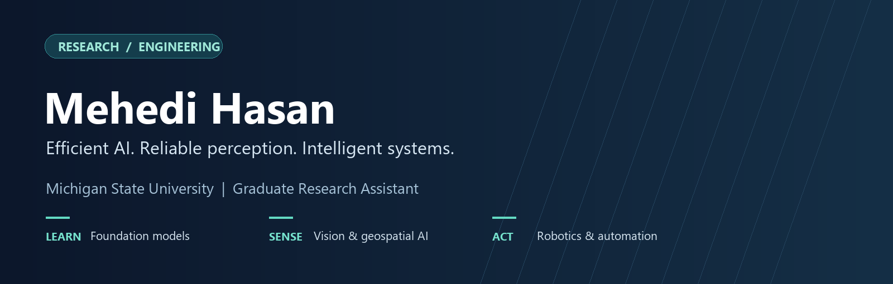

### Welcome — I'm Mehedi

**Graduate Research Assistant · Michigan State University**  
M.S. in Biosystems Engineering · B.S. in Computer Science, BRAC University

[Website](https://sites.google.com/view/i-am-mehedi) &nbsp; / &nbsp; [Google Scholar](https://scholar.google.com/citations?user=i_9-VFoAAAAJ&hl=en) &nbsp; / &nbsp; [LinkedIn](https://www.linkedin.com/in/mehedihasan96/) &nbsp; / &nbsp; [Email](mailto:hasanme1@msu.edu)

**Seeking Fall 2027 PhD opportunities in AI, computer vision, and intelligent systems.**

I develop learning and perception methods that connect **computational efficiency**, **reliable evaluation**, and **physical systems**. My work spans pathology foundation models, parameter-efficient language-model adaptation, vision-language learning, industrial reliability, remote-sensing segmentation, and vision-guided robotics.

At Michigan State, I work on machine vision and robotic manipulation for automated handling of deformable food products. My background also includes research collaborations in medical AI and privacy-preserving learning, engineering at Huawei, and rover perception with BRACU Mongol Tori.

## Research directions

| Learn efficiently | Sense the world | Decide reliably |
| --- | --- | --- |
| Foundation models, LLMs/VLMs, pruning, PEFT, and distillation | Computer vision, remote sensing, geospatial AI, robotic perception, and intelligent sensing | Calibration, uncertainty, selective prediction, OOD evaluation, and privacy-preserving learning |

## Selected projects

<table>
<tr>
<td width="50%" valign="top">

### [TAP-Path](https://github.com/mhasan96/TAP-Path)
**Efficient pathology foundation models**

Structural and token pruning for Virchow2. The manuscript reports **24.96% fewer encoder parameters** and **35.20% lower analytical encoder FLOPs**.

*Preprint / under review* · [Paper](https://arxiv.org/abs/2609.04071)

</td>
<td width="50%" valign="top">

### [CIRR-MoE](https://github.com/mhasan96/CIRR-MoE)
**Decision-specific trustworthy prediction**

Cross-fitted expert routing that separates **competence, failure risk, and unfamiliarity**, with external industrial and conformal evaluation.

*Manuscript under review* · [Project and results](https://github.com/mhasan96/CIRR-MoE)

</td>
</tr>
<tr>
<td width="50%" valign="top">

### [ChainDoRA](https://github.com/mhasan96/ChainDoRA)
**Parameter-efficient LLM adaptation**

Co-developed connected Tensor-Train directional adaptation. The paper reports **72.30%** seven-task average with **5.35M** trainable parameters on LLaMA-7B.

*Preprint* · [Paper](https://doi.org/10.13140/RG.2.2.25941.18402) · [Collaborator repository](https://github.com/AshfakYeafi/Chain-DoRA)

</td>
<td width="50%" valign="top">

### [LIA-MTR](https://github.com/mhasan96/LIA-MTR)
**Memory-efficient vision-language learning**

Co-developed a gated recurrent bridge for visual context, combining **linear sequence interaction** with multi-timescale retention.

*arXiv preprint* · [Paper](https://arxiv.org/abs/2608.01614)

</td>
</tr>
<tr>
<td width="50%" valign="top">

### [AquaPick](https://github.com/mhasan96/AquaPick)
**Vision-guided robotic handling**

Detection, tracking, conveyor-motion prediction, camera-to-robot mapping, and suction manipulation for **deformable catfish fillets**.

*Ongoing journal work; related SPIE/ASABE papers* · [Research and experiments](https://github.com/mhasan96/AquaPick)

</td>
<td width="50%" valign="top">

### [LoveDA Remote Sensing](https://github.com/mhasan96/LoveDA-Remote-Sensing)
**Resolution-aware land-cover mapping**

SegFormer-B2 reached **53.09% mIoU on 1,669 validation images** using native 1024 × 1024 tiled inference, versus 49.45% with 512 resized inference.

*Ongoing experimental project* · [Protocols and class-wise results](https://github.com/mhasan96/LoveDA-Remote-Sensing)

</td>
</tr>
</table>

Project pages include figures, result definitions, and evaluation scope. Paper results are reported measurements from the respective studies. **Code will be available upon acceptance of the corresponding paper.**

## Experience

**Michigan State University — Graduate Research Assistant**  
Machine vision, intelligent sensing, robotic manipulation, and physical system evaluation for automated IQF preparation.

**Research collaborations — BRAC University and partner institutions**  
Medical AI, efficient NLP and foundation models, industrial machine learning, and privacy-preserving analytics.

**Huawei Technologies Bangladesh — Solution Engineer**  
Service and network analytics, engineering support, and technical training.

**BRACU Mongol Tori — AI / Autonomy**  
Earlier work on rover perception, marker-based localization, obstacle avoidance, and vision-assisted navigation.

## Research and engineering toolkit

| Area | Tools and methods |
| --- | --- |
| Learning | Python, PyTorch, TensorFlow/Keras, Hugging Face Transformers/PEFT, scikit-learn |
| Vision and robotics | OpenCV, YOLO, ROS/ROS2, Kalman tracking, camera calibration, coordinate mapping |
| Research computing | C/C++, SQL, MATLAB, Linux, Git, Docker, Jupyter, LaTeX |
| Software development | JavaScript/TypeScript, React, Node.js, MySQL, MongoDB, Firebase |

## Audience

Approximate image loads, including repeat loads; this is not a unique-visitor count. Repository views and unique visitors are available to the owner through GitHub Insights.

## Publications and collaboration

My publication record includes work in **IEEE Journal of Biomedical and Health Informatics**, **IEEE Access**, and conference venues. See [Google Scholar](https://scholar.google.com/citations?user=i_9-VFoAAAAJ&hl=en) for the complete record and my [website](https://sites.google.com/view/i-am-mehedi) for research updates.

I welcome conversations about **Fall 2027 PhD opportunities** and research in efficient AI, trustworthy learning, computer vision, remote sensing, and robotic perception.

**[hasanme1@msu.edu](mailto:hasanme1@msu.edu)**
